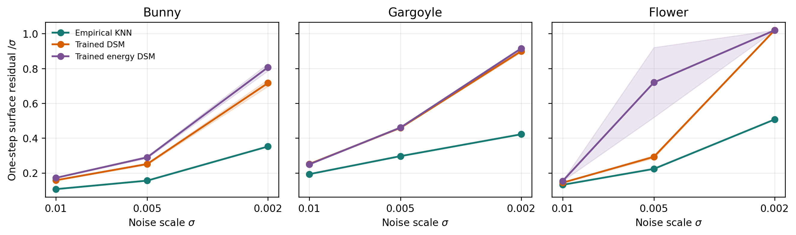
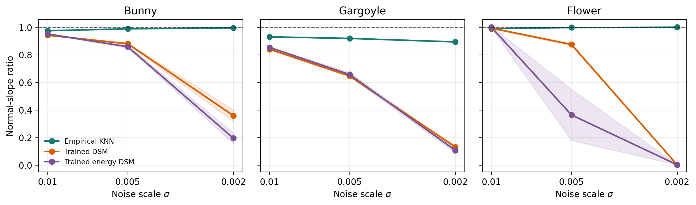

# Empirical score versus trained score at small noise scales

This experiment compares the empirical Gaussian-weighted KNN score used by
the low-dimensional method with direct and conservative energy-based DSM
networks. Bunny, Gargoyle, and Flower provide the real-shape comparison, and
the unit sphere provides an analytic sanity check.

These are supplementary experiments, separate from the manuscript's main
27-shape reconstruction benchmark and Tables 1--4. The sphere report writes
`results/sphere/table_sphere_score_comparison.tex`.

## Real-shape validation

All geometries use the same normalization as the reconstruction code: subtract
the float32 point-cloud mean and divide by the maximum centered radius. Bunny
and Flower are sampled area-uniformly from their reference meshes. Gargoyle is
sampled continuously from local tangent patches fitted to its oriented scan,
because the available reference is an oriented point set rather than a closed
triangle mesh.

For every shape, the empirical estimator uses a fixed 40M-point clean support
and an automatically selected KNN size that retains 99% of the local Gaussian
mass with a safety margin. Each trained baseline uses the same clean
distribution, a four-block 256-wide residual MLP, batch size 4,096, and 30,000
updates (122.88M noisy examples per model). Separate models are trained at
`sigma = 0.01`, `0.005`, and `0.002`; trained values are mean ± sample standard
deviation over seeds `20260828`, `20260829`, and `20260830`. This gives 54
trained models in total.

## Real-shape small-noise result

The table below reports the main geometric quantities at `sigma = 0.002`.
Surface residual is the mean distance to an independent 2M-point reference
after one score-based denoising step, divided by `sigma`. The normal-slope ratio
measures the restoring slope over normal offsets in `[-sigma, sigma]`; one is
ideal.

| Shape | Score estimator | Surface residual / `sigma` ↓ | Normal-slope ratio → 1 |
|:---|:---|---:|---:|
| Bunny | Empirical KNN | **0.3517** | **0.995** |
|  | Direct DSM | 0.7163 ± 0.0196 | 0.358 ± 0.043 |
|  | Energy DSM | 0.8065 ± 0.0206 | 0.194 ± 0.038 |
| Gargoyle | Empirical KNN | **0.4221** | **0.893** |
|  | Direct DSM | 0.8996 ± 0.0070 | 0.131 ± 0.012 |
|  | Energy DSM | 0.9153 ± 0.0073 | 0.107 ± 0.019 |
| Flower | Empirical KNN | **0.5071** | **0.999** |
|  | Direct DSM | 1.0197 ± 0.0003 | 0.0019 ± 0.0003 |
|  | Energy DSM | 1.0192 ± 0.0008 | 0.0021 ± 0.0013 |

At `sigma = 0.002`, empirical KNN reduces the one-step surface residual by
approximately 50%--56% relative to the trained estimators on all three shapes.
The normal profile identifies the mechanism: the empirical field retains a
near-unit restoring slope, while the learned fields become strongly
over-smoothed, and almost completely collapse on Flower. The same ordering is
already present at `sigma = 0.005` and `0.01`, but the gap widens as the noise
scale decreases.





The retained real-shape measurements are provided as:

- [`table_real_shapes.tex`](results/real_shapes/table_real_shapes.tex):
  LaTeX table covering all shapes, methods, and noise scales.
- [`summary.csv`](results/real_shapes/summary.csv) and
  [`per_run.csv`](results/real_shapes/per_run.csv): aggregate and seed-level
  measurements.
- [`normal_profiles.csv`](results/real_shapes/normal_profiles.csv): measured
  normal score profiles.
- [`protocol.json`](results/real_shapes/protocol.json): data hashes, sampling
  rules, seeds, model settings, and evaluated KNN sizes.
- [`training_trace_summary.csv`](results/real_shapes/training_trace_summary.csv)
  and [`training_logs/`](results/real_shapes/training_logs/): compact
  optimization evidence for all 54 trained models.

## Reproduce the real-shape comparison

Install the method and reporting dependencies from the repository root:

```bash
python -m pip install -r experiments/empirical_vs_trained_small_sigma/requirements.txt
```

Fetch the bundled inputs with `git lfs pull`.
The launcher uses the repository root as `ASSET_ROOT` and
accepts any subset of `bunny`, `gargoyle` and `flower` through `DATASETS`.

The Bunny experiment uses bundled inputs. Gargoyle requires an additional
normalization point cloud and oriented scan. Exact replay of the retained
Flower experiment uses an additional reference mesh. Their required hashes
and acquisition details are listed in [`assets/README.md`](assets/README.md).
The retained input identities are also recorded in
[`protocol.json`](results/real_shapes/protocol.json).

From the repository root, a Bunny-only run is:

```bash
cd experiments/empirical_vs_trained_small_sigma
DATASETS=bunny GPU_IDS=0 bash launch_real_shapes.sh
```

To run all three shapes from that experiment directory:

```bash
GPU_IDS="0 1 2" \
GARGOYLE_POINT_CLOUD=/path/to/gargoyle_pointcloud_100k.csv \
FLOWER_SURFACE=/path/to/flower_reference_mesh.npz \
STEPS=30000 \
N_SUPPORT=40000000 \
N_REFERENCE=2000000 \
OUTPUT_ROOT=outputs/real_shapes_30k \
bash launch_real_shapes.sh
```

The launcher prepares the fixed supports and independent references, trains
all direct and energy DSM models, and finally writes the tables and figures.
Checkpoints and the regenerable dense supports are excluded from Git.
Relative `OUTPUT_ROOT` paths are resolved from the experiment directory.

## Analytic sphere control

The unit-sphere experiment compares all estimators with the exact
Gaussian-smoothed population score, avoiding any reference-surface
approximation. Its code is in [`experiment.py`](experiment.py), its launcher is
[`launch_server.sh`](launch_server.sh), and its retained outputs are under
[`results/sphere/`](results/sphere/).

From the experiment directory, run it on one GPU with:

```bash
STEPS=30000 OUTPUT_ROOT=outputs/sphere_30k bash launch_server.sh
```

Set `GPU_IDS="0 1 2 3"` to distribute training jobs across four GPUs.

## Reported quantities

- `denoise_rmse_over_sigma`: RMSE to the paired clean sample after one score
  step, divided by `sigma`.
- `surface_mae_over_sigma`: mean distance to the independent surface reference
  after one score step, divided by `sigma`.
- `angle_mean_deg`: mean direction error against the paired clean displacement
  where that displacement is at least `0.25 * sigma`.
- `normal_slope_ratio`: fitted restoring slope over normalized normal offsets;
  one is ideal and values below one indicate an over-smoothed normal transition.
